  

---

## About Me

- Currently learning **React.js + Vite**
- Planning to go deeper into **backend development**
- I can work with **frontend + backend**
- Fun fact: I am weird

---

## Contribution Graph

---

## Skills

---

## Projects

---

## Connect

