  

---

## ✨ About Me

- 🔭 Currently learning Reactjs+Vite
- 🌱 Planned to work on backend devlopment
- 💬 I can work with frontend+backend
- ⚡ Fun fact: I am weird

---

## 📊 Contribution Bar Graph

---

## 🧠 Languages & Skills

 

 

  

---

## 🏆 Featured Projects

---

## 📫 Connect

  

